# sho-herdr-mode

[English](README.md) · **Español**

Un layout para la app de escritorio de [Herdr](https://herdr.dev), pensado para trabajar con muchos agentes a la vez. A la izquierda van los espacios, los agentes y lo que corre debajo. En el centro va el trabajo. A la derecha hay un panel que cambia entre Files, Issues, Graph, Notes y Planes. Es una sola ventana para todo el ciclo, desde la idea hasta el PR fusionado.

[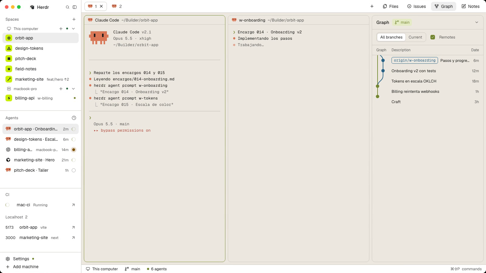](media/sho-herdr-mode.mp4)

▶ **[Mira el video de 1 minuto](media/sho-herdr-mode.mp4)** (MP4, 5 MB, en español).

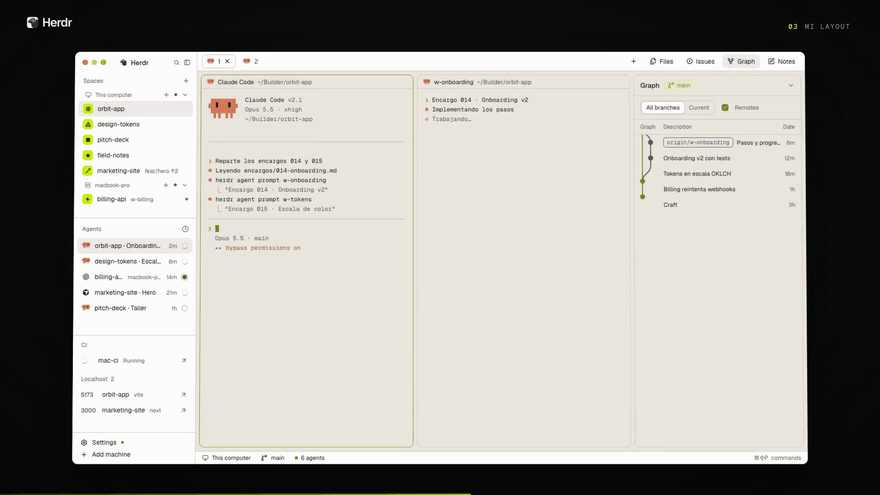

---

## Contenido

- [Qué trae](#qué-trae)
- [Recorrido](#recorrido)
- [Instalación](#instalación)
- [Ajustes de los paneles opcionales](#ajustes-de-los-paneles-opcionales)
- [Atajos](#atajos)
- [El panel Planes y plan-estado](#el-panel-planes-y-plan-estado)
- [Qué hay en el repo](#qué-hay-en-el-repo)
- [Actualizar y desinstalar](#actualizar-y-desinstalar)
- [Para agentes](#para-agentes)
- [Créditos y licencia](#créditos-y-licencia)

## Qué trae

| Dónde | Qué muestra | Mod |
| --- | --- | --- |
| Izquierda, arriba | **Spaces**. Uno por repo, en cada Mac que agregaste, con un ícono de color fijo, su rama y cuánto va adelante o atrás. Los worktrees van debajo de su checkout. El `+` abre **Repositories**. | `craft-spaces`, `craft-repos` |
| Izquierda, en medio | **Agents**. Quién trabaja, quién te espera y quién terminó mientras no mirabas. | `agents` de Herdr |
| Izquierda, abajo | **CI**, opcional (una VM de Lima con un runner de GitHub Actions), y **Localhost**, con cada servidor de desarrollo que escucha en tu Mac. Un clic lo abre y dos lo detienen. | `craft-local` |
| Arriba | **Pestañas** con el ícono y el estado de cada agente, los botones del panel y un cierre con confirmación. | `craft-tabs` |
| Centro | Los paneles de la pestaña, como tarjetas. | de Herdr |
| Panel derecho | **Files**, **Issues**, **Graph**, **Notes** y **Planes**, uno a la vez, recordado por espacio. | `files`, `craft-issues`, `git-graph`, `craft-notes`, `craft-plans` |
| En todas partes | ⌘W y ⌘⇧W preguntan antes de cerrar una pestaña o un panel. | `tab-guard`, `pane-guard` |
| Aspecto | La paleta de Craft, en claro y oscuro, según tu sistema. | `themes/craft-light.json`, `themes/craft-dark.json` |

## Recorrido

Cuadros del [video](media/sho-herdr-mode.mp4). Los datos que se ven son de ejemplo.

### El layout, desarmado

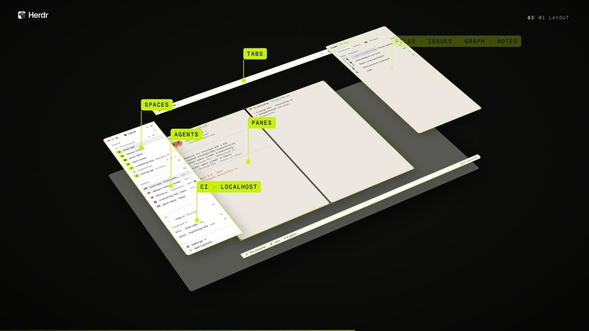

### Spaces, cada repo en cada Mac

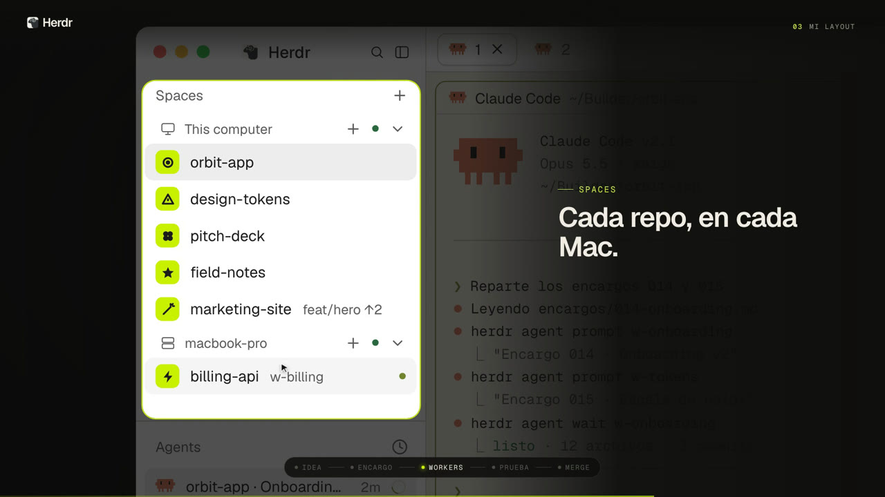

Cuando tienes más de una máquina, los espacios se agrupan por máquina. Un clic cambia de espacio, el clic derecho abre su menú y se reordenan arrastrando. El `+` lista cada repo de GitHub donde puedes hacer push, del más reciente al más viejo. Enter abre un espacio en su clon y lo clona si no existe. ⌘↩ además arranca Claude Code ahí.

### Agents, quién trabaja y quién espera

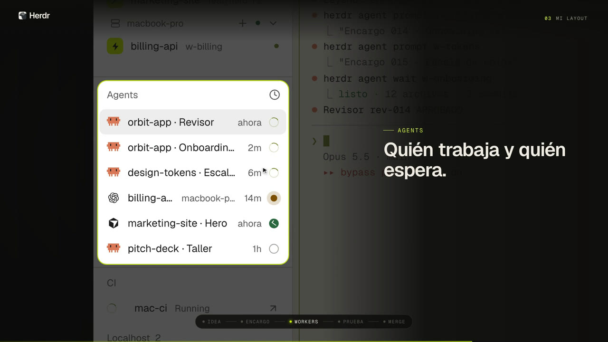

### Paneles y Files, el trabajo y su código lado a lado

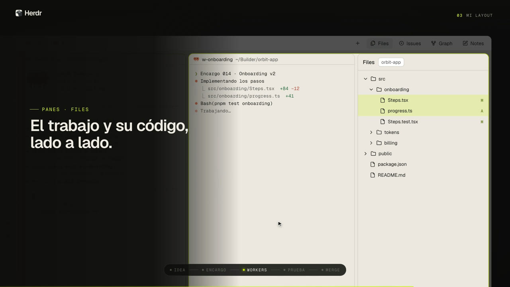

### CI y Localhost, pruebo lo que corre

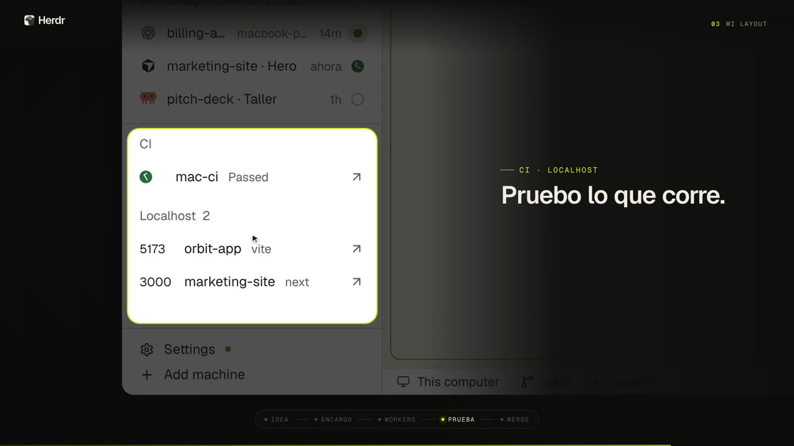

Localhost encuentra cada runtime o herramienta de desarrollo que escucha en tu Mac (Vite, Next…) y dice de qué proyecto es. Un clic en un servidor lo abre. Su botón de detener, presionado dos veces, lo detiene junto con lo que arrancó. La fila de CI es opcional (mira [Ajustes](#ajustes-de-los-paneles-opcionales)).

### Issues, del reporte al agente en un clic

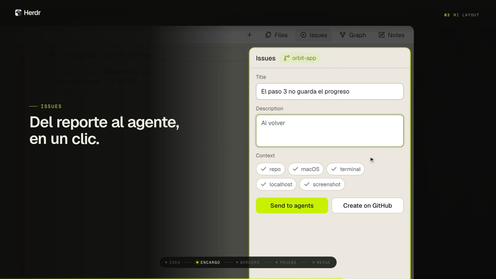

Lo escribes una vez, como bug, mejora o tarea. Después lo mandas a los agentes de la pestaña que estás viendo (⌘↩) o lo creas en GitHub con `gh` y le pasas su número a un agente (⌘⇧↩). El contexto se junta al enviarlo, cada parte solo si su chip está activo. Puede incluir el repo, macOS, las últimas líneas del terminal, los servidores locales y una captura.

### Notes, la idea y sus to-dos

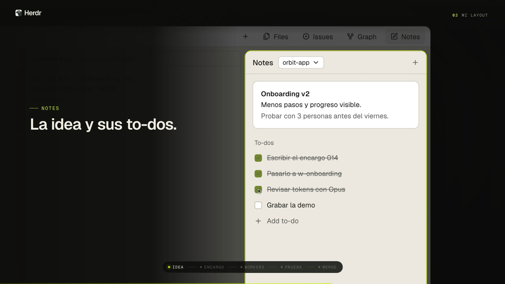

Una nota y una lista de to-dos por proyecto. Los proyectos son tuyos y no dependen de un espacio, así que cerrar un espacio nunca esconde una nota.

### Graph, ramas y PRs listos para merge

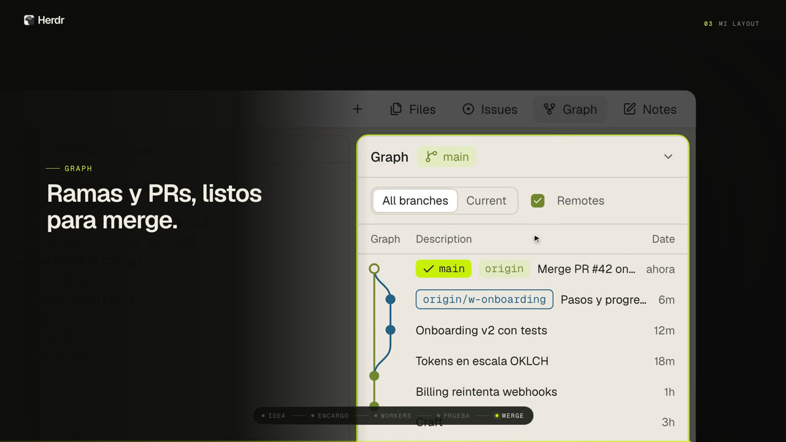

Es [herdr-git-graph](https://github.com/rabeeh-ta/herdr-git-graph), de Rabeeh T A, con los colores de Craft. Los cambios están en [`mods/git-graph/CRAFT.md`](mods/git-graph/CRAFT.md).

### Planes, cada unidad de trabajo como una rama

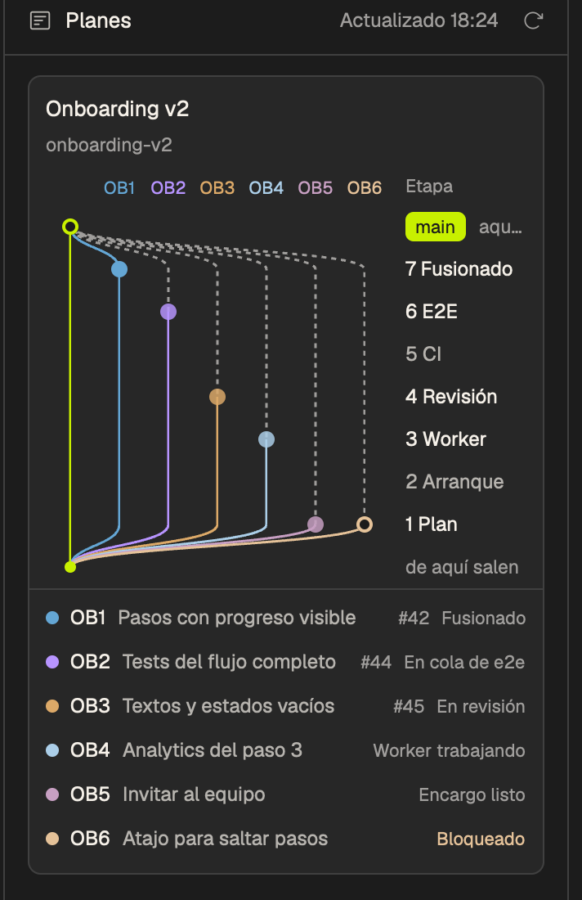

Cada unidad de un plan sale de `main`, sube por siete tramos (Plan, Arranque, Worker, Revisión, CI, E2E y Fusionado) y vuelve a `main` cuando su PR se fusiona. La línea es sólida hasta donde va y punteada después. Un anillo marca una unidad bloqueada. Lee los `estado.json` que escribe el comando `plan-estado`, que viene incluido. Más en [El panel Planes](#el-panel-planes-y-plan-estado).

### Cerrar a propósito

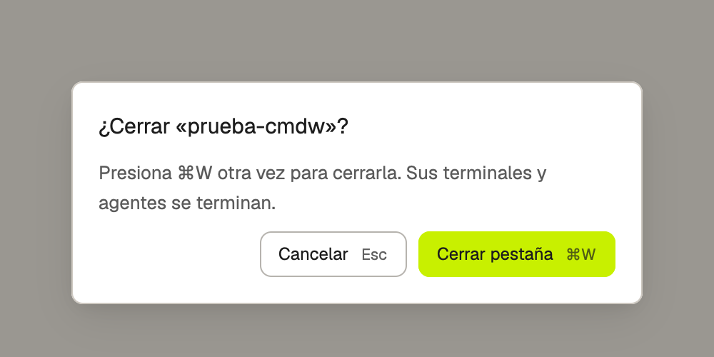

⌘W y ⌘⇧W abren un diálogo con el nombre de la pestaña o del panel. Solo se cierra con la misma tecla otra vez o con su botón. Esc, un clic fuera o cualquier otra tecla lo cancelan, y Enter no hace nada, así que un mensaje que estabas escribiendo no cierra nada. Los cierres que hacen los scripts y los agentes no pasan por el diálogo. La ✕ de la barra de pestañas también pregunta.

## Instalación

**Necesitas** la app de escritorio de Herdr (hecho sobre la 0.1.15, en macOS), abierta al menos una vez, y `python3`. Los paneles que hablan con GitHub (Issues, Graph, Planes y Repositories) necesitan `git` y la [CLI de GitHub](https://cli.github.com) con sesión iniciada.

```sh
git clone https://github.com/johanvillalbab/sho-herdr-mode.git
cd sho-herdr-mode
./install.sh --dry-run   # muestra lo que agregaría
./install.sh             # instala y cambia Herdr a este layout
```

Qué hace `install.sh`:

- Copia el layout, los dos temas y los mods a `~/.config/herdr-app` (o a `$HERDR_APP_HOME`).
- Agrega los [atajos](#atajos) a tu `keys.json`. Los ⌘W y ⌘⇧W de Herdr se cambian por las confirmaciones de cierre. Cualquier otra tecla que ya uses se queda como está y te la avisa.
- Nunca sobrescribe. Si un archivo tuyo fuera a cambiar, se detiene y lo lista. `./install.sh --replace` mueve antes esos archivos a `~/.config/herdr-app/backup-sho-herdr-mode-<hora>/` y conserva tus ajustes `config.json`.
- Corre `herdr-app check` sobre cada mod y cambia Herdr a este layout. Tu layout se queda, y `layout.switch` (⌘⇧L) te devuelve a él.
- `--plan-estado` además instala el comando `plan-estado` en `~/.local/bin`.

Correrlo otra vez es seguro, porque se salta lo que ya está igual.

**A mano.** Copia `layouts/main-craft.json`, `layouts/main-craft.png`, `themes/*.json` y cada carpeta de `mods/` a los mismos lugares dentro de `~/.config/herdr-app`, junta `keys.json` con el tuyo y corre `herdr-app do layout.switch --name main-craft`.

## Ajustes de los paneles opcionales

Tres paneles tienen ajustes personales. Cada carpeta trae un `config.example.json`. Cópialo como `config.json` en la misma carpeta y edítalo. Al guardarlo, el panel se recarga. El `config.json` es tuyo, así que el instalador lo conserva y git lo ignora.

**`mods/craft-local/config.json`**, para la fila de CI. Sin este archivo, Localhost se muestra solo.

```json
{ "vm": "mac-ci", "repo": "tu-usuario/tu-repo", "runnerLabel": "mac-ci" }
```

`vm` es una VM de [Lima](https://lima-vm.io) (`limactl list`), `repo` es el repo al que sirve su runner de GitHub Actions y `runnerLabel` es la etiqueta del runner. El punto se pone lima mientras corre un trabajo, verde cuando está listo y ámbar cuando la VM está arriba pero su runner no.

**`mods/craft-repos/config.json`**, para elegir dónde van los clones nuevos dentro de tu carpeta personal (por defecto `Developer`).

```json
{ "cloneInto": "Developer" }
```

**`mods/craft-plans/config.json`**. Mira [El panel Planes](#el-panel-planes-y-plan-estado).

```json
{ "plansDir": "plans", "otherMachine": null, "repo": "tu-usuario/tu-repo" }
```

Algunos paneles están en español, como su autor. Son Planes, los diálogos de cierre y el mensaje que Issues manda a los agentes, cuya última línea es la constante `ASK` al principio de `mods/craft-issues/main.js`.

## Atajos

| Teclas | Dónde | Qué hace |
| --- | --- | --- |
| ⌘W | en todas partes | pregunta y cierra la pestaña con un segundo ⌘W |
| ⌘⇧W | en todas partes | pregunta y cierra el panel con un segundo ⌘⇧W |
| ⌘⌥B | este layout | muestra u oculta el panel derecho |
| ⌘G | este layout | Graph |
| ⌘⇧I | este layout | Issues |
| ⌘⇧N | este layout | Notes |
| ⌘⇧O | este layout | Planes |
| ⌘↩ / ⌘⇧↩ | Issues | mandar a los agentes de la pestaña / crear en GitHub |

Los atajos de Herdr siguen funcionando (⌘B para la barra lateral, ⌘D para dividir, ⌘1…9 para las pestañas y ⌘⇧P para la paleta).

## El panel Planes y plan-estado

El panel Planes sirve a quien organiza el trabajo en **planes** hechos de **unidades**. Una unidad es una rama y un PR, que se encarga a un agente y se revisa antes de fusionarla. Cada plan es una carpeta con un `estado.json`.

```json
{
  "version": 1,
  "paquete": "onboarding-v2",
  "titulo": "Onboarding v2",
  "estado": "activo",
  "artefactos": [{ "titulo": "Decisión: pasos", "url": "https://…", "decision": "decidida", "fecha": "2026-11-17", "resumen": "…" }],
  "unidades": [
    {
      "id": "OB1", "titulo": "Pasos con progreso visible", "fase": "worker",
      "mac": "air", "poteto": false, "rama": "ui/ob1-pasos", "pr": null,
      "depende": [], "encargo": "encargos/OB1.md", "nivel": null,
      "nota": "", "actualizado": "2026-11-17T22:00:58Z"
    }
  ],
  "actualizado": "2026-11-17T22:00:58Z"
}
```

La `fase` de una unidad corresponde a los siete tramos:

| Tramo | Fases |
| --- | --- |
| Plan | `decidido`, `encargo` |
| Arranque | `preparando`, `enviado` |
| Worker | `worker`, `cierre-worker` |
| Revisión | `revision`, `ronda` |
| CI | `ci` |
| E2E | `cola-e2e`, `cadena` |
| Fusionado | `fusionado`, `visto` |

Además están `bloqueado` y `descartado`. GitHub adelanta una unidad cuando va por delante. Un PR abierto en su rama la pone al menos en Worker, y uno fusionado la pone en Fusionado. Un clic en una unidad abre su archivo de `encargo`.

**Ajustes** (`mods/craft-plans/config.json`):

- `plansDir` es la carpeta de planes, relativa a tu carpeta personal en cada máquina. Por defecto usa la de `plan-estado` o `~/plans`.
- `otherMachine` es una máquina de `hc machine ls` cuya carpeta de planes también se lee. En cada unidad gana el `actualizado` más reciente. Usa `null` si no hay otra.
- `repo` es el repo de GitHub cuyos PRs adelantan las unidades. Usa `null` si no hay ninguno.

**`plan-estado`** es la única forma de escribir estos archivos, para que nadie edite el JSON a mano. Está hecho en Python 3.9, solo con la biblioteca estándar, y escribe de forma atómica y con candado.

```sh
plan-estado <plan> --crear "<título>"                        # crea estado.json
plan-estado <plan> --nueva <unidad> "<título>" [rama=… poteto=si|no encargo=…]
plan-estado <plan> <unidad> fase=<fase> [pr=<n>] [mac=air|pro] [nivel=N1] [nota="…"] [depende=OB1,OB2]
plan-estado <plan> --cerrar                                  # cierra el plan
plan-estado decision <url> pendiente|decidida "<título>" [paquete=…] [nota="…"]
plan-estado ver [<plan>]                                     # imprime el estado
plan-estado … --on <máquina>                                 # lo corre en otra máquina (hc exec)
```

Su carpeta es `$PLAN_ESTADO_DIR`, si no `dir` en `~/.config/plan-estado/config.json` (relativa a tu carpeta personal), y si no `~/plans`. Se instala con `./install.sh --plan-estado`.

## Qué hay en el repo

```
layouts/main-craft.json    el layout (y main-craft.png, su imagen en Settings)
themes/craft-*.json        claro y oscuro
mods/craft-tabs            barra de pestañas y botones del panel
mods/craft-spaces          barra de espacios
mods/craft-repos           el "+" de Spaces: tus repos de GitHub
mods/craft-local           CI y Localhost
mods/craft-issues          Issues
mods/craft-notes           Notes
mods/craft-plans           Planes
mods/git-graph             Graph (herdr-git-graph, con los colores de Craft)
mods/tab-guard, pane-guard confirmaciones de cierre
keys.json                  los atajos que install.sh agrega a los tuyos
tools/plan-estado          el comando que escribe el estado de los planes
install.sh                 el instalador
RECIPE.md                  un brief para reconstruirlo desde cero
media/                     el video, sus cuadros y capturas
```

Las piezas de Herdr que usa el layout (`agents`, `files`, `pane`, `workspace-chrome` y `workspace-status`) ya vienen con Herdr y no se copian.

## Actualizar y desinstalar

**Actualizar.** Corre `git pull` y después `./install.sh --replace`. Tus `config.json` se quedan.

**Desinstalar.** Cambia a otro layout (⌘⇧L) y borra lo que se agregó.

```sh
cd ~/.config/herdr-app
rm -r layouts/main-craft.json layouts/main-craft.png themes/craft-light.json themes/craft-dark.json \
  mods/craft-tabs mods/craft-spaces mods/craft-repos mods/craft-local mods/craft-issues \
  mods/craft-notes mods/craft-plans mods/git-graph mods/tab-guard mods/pane-guard
```

Después saca de `keys.json` las secciones de este repo (`mod:tab-guard`, `mod:pane-guard` y `layout:main-craft`) y devuelve ⌘W y ⌘⇧W de `global` a `tab.close` y `pane.close`. Si prefieres tu `keys.json` completo, el instalador lo dejó en la carpeta de respaldo.

## Para agentes

Si alguien te pide instalar esto, lee primero [RECIPE.md](RECIPE.md) e `install.sh`. Avísale que los mods corren programas (`git`, `gh`, `hc`, `lsof`, `limactl`) y leen archivos de su carpeta personal. Luego corre `./install.sh --dry-run` y muéstrale el plan antes de `./install.sh`. Nunca sobrescribas sus archivos sin `--replace` y sin su sí. Después de instalar, `herdr-app status` no debe mostrar errores, y `herdr-app shot` te deja ver la ventana.

## Créditos y licencia

- Layout y mods de [Sho](https://github.com/johanvillalbab), para la app de escritorio de [Herdr](https://herdr.dev).
- Graph es [herdr-git-graph](https://github.com/rabeeh-ta/herdr-git-graph), de Rabeeh T A (MIT, [`mods/git-graph/LICENSE`](mods/git-graph/LICENSE)).
- Íconos de [Phosphor](https://phosphoricons.com) (MIT).
- Las figuras del video son de Hairline.

MIT, mira [LICENSE](LICENSE).
