# sho-herdr-mode

**English** · [Español](README.es.md)

A layout for the [Herdr](https://herdr.dev) desktop app, built for running many coding agents at once: spaces on the left, the agents and what's running under them, the work in the middle, and a right panel that switches between Files, Issues, Graph, Notes and Plans. One window for the whole loop, from an idea to a merged PR.

[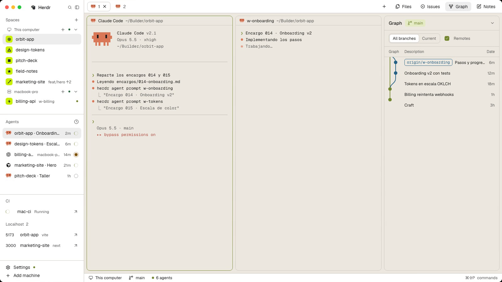](media/sho-herdr-mode.mp4)

▶ **[Watch the 1-minute video](media/sho-herdr-mode.mp4)** (MP4, 5 MB, captions in Spanish).

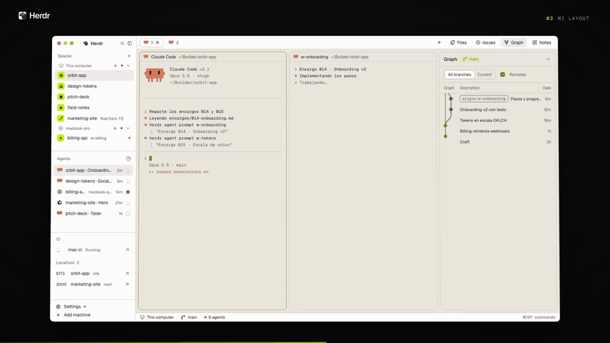

---

## Contents

- [What you get](#what-you-get)
- [A tour](#a-tour)
- [Install](#install)
- [Settings for the optional panels](#settings-for-the-optional-panels)
- [Keys](#keys)
- [The Plans panel and plan-estado](#the-plans-panel-and-plan-estado)
- [What's in this repo](#whats-in-this-repo)
- [Update and uninstall](#update-and-uninstall)
- [For agents](#for-agents)
- [Credits and license](#credits-and-license)

## What you get

| Where | What it shows | Mod |
| --- | --- | --- |
| Left, top | **Spaces**: one per repo, on every Mac you've added, with a stable colored icon, its branch and how far ahead or behind it is. Worktrees sit under their checkout. `+` opens **Repositories**. | `craft-spaces`, `craft-repos` |
| Left, middle | **Agents**: who is working, who is waiting for you, who finished while you were away. | Herdr's own `agents` |
| Left, bottom | **CI** (optional: a Lima VM running a GitHub Actions runner) and **Localhost**: every dev server listening on your Mac, one click to open it, two to stop it. | `craft-local` |
| Top | **Tabs** with each agent's icon and status, the panel buttons, and a guarded close. | `craft-tabs` |
| Middle | The tab's panes as cards. | Herdr's own |
| Right panel | **Files**, **Issues**, **Graph**, **Notes** and **Plans**, one at a time, remembered per space. | `files`, `craft-issues`, `git-graph`, `craft-notes`, `craft-plans` |
| Everywhere | ⌘W and ⌘⇧W ask before a tab or a pane closes. | `tab-guard`, `pane-guard` |
| Look | Craft's palette, light and dark, following your system. | `themes/craft-light.json`, `themes/craft-dark.json` |

## A tour

Frames from the [video](media/sho-herdr-mode.mp4). The data in them is made up.

### The layout, taken apart

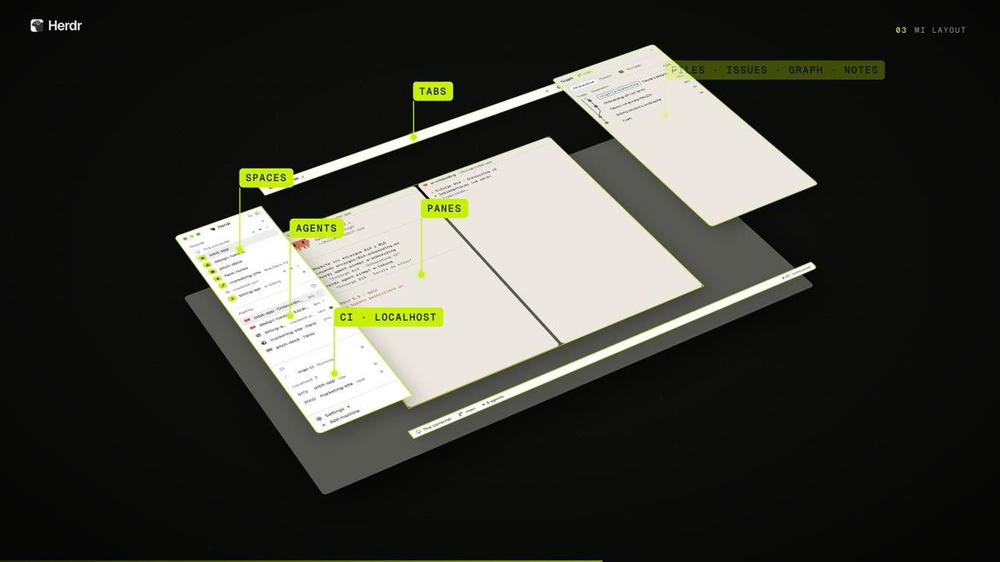

### Spaces: each repo, on each Mac

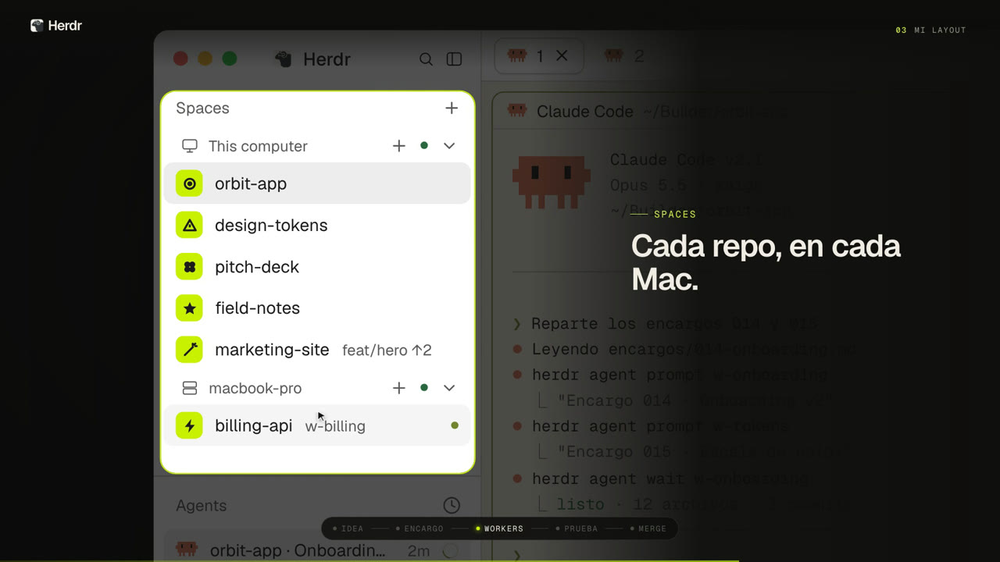

Spaces are grouped by machine when you have more than one. Click to switch, right-click for its menu, drag to reorder. The `+` lists every GitHub repo you can push to, newest first: Enter opens a space in its clone (cloning it if there's none), ⌘↩ also starts Claude Code there.

### Agents: who works and who waits

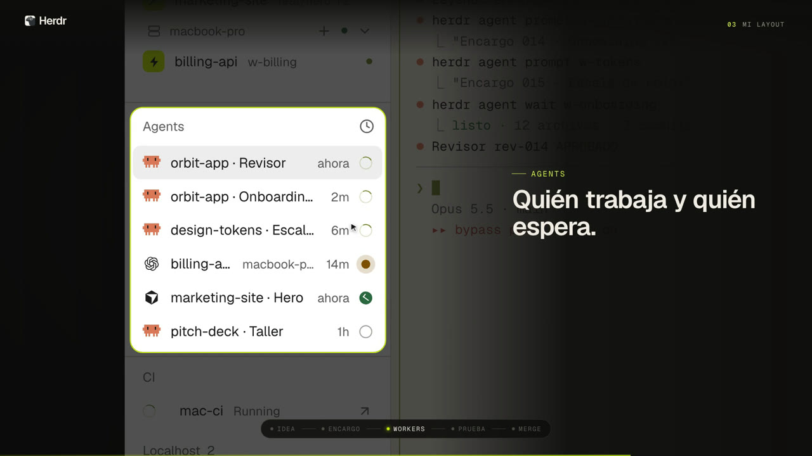

### Panes and Files: the work and its code, side by side

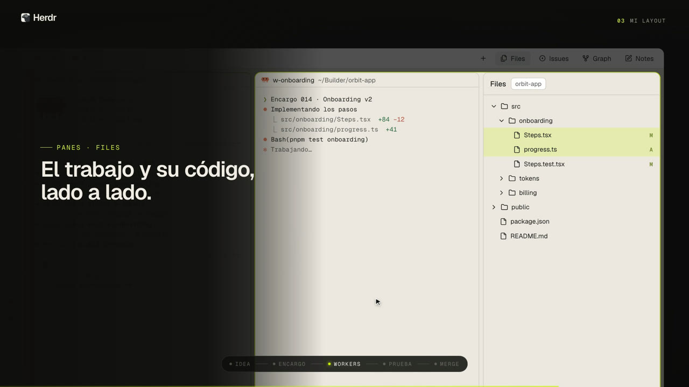

### CI and Localhost: test what's running

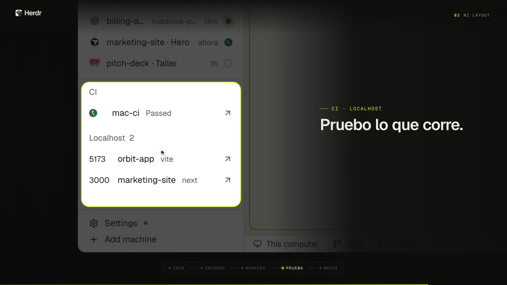

Localhost finds every runtime or dev tool listening on your Mac (Vite, Next, and so on) and names its project. Click a server to open it; its stop button, pressed twice, stops it and what it started. The CI row is optional (see [Settings](#settings-for-the-optional-panels)).

### Issues: from a report to an agent, in one click

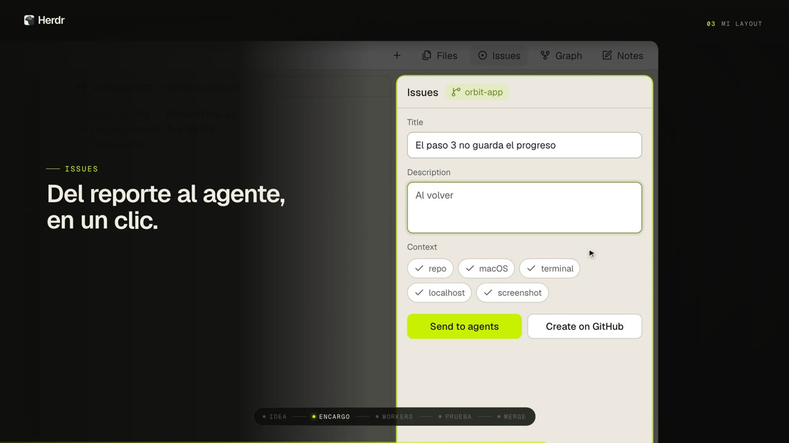

Write it once, as a bug, feature or task. Then send it to the agents in the shown tab (⌘↩) or create it on GitHub with `gh` and hand its number to an agent (⌘⇧↩). The context is gathered when it's sent, each piece only while its chip is on: the repo, macOS, the terminal's last lines, local servers, a screenshot.

### Notes: the idea and its to-dos

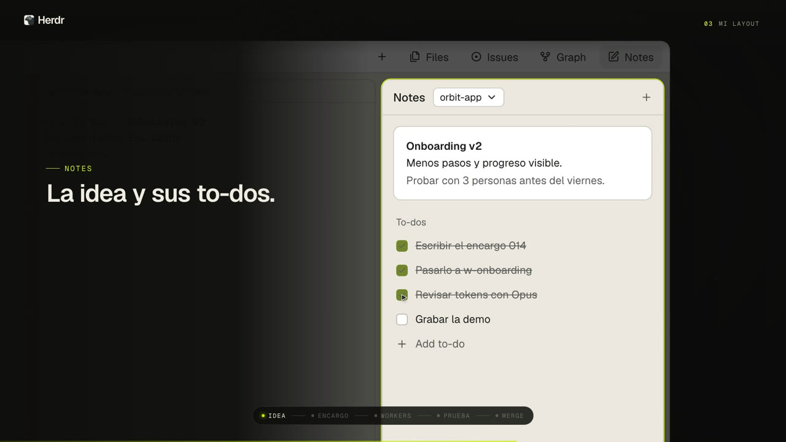

A note and a to-do list per project. Projects are yours, not tied to a space, so closing a space never hides a note.

### Graph: branches and PRs, ready to merge

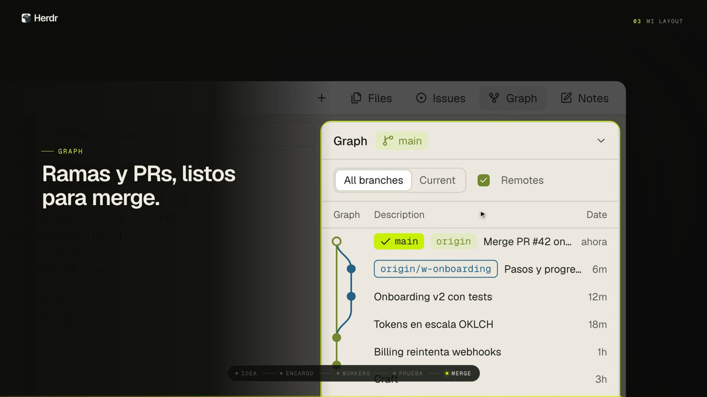

[herdr-git-graph](https://github.com/rabeeh-ta/herdr-git-graph) by Rabeeh T A, in Craft's colors (the changes are listed in [`mods/git-graph/CRAFT.md`](mods/git-graph/CRAFT.md)).

### Plans: each unit of work as a branch

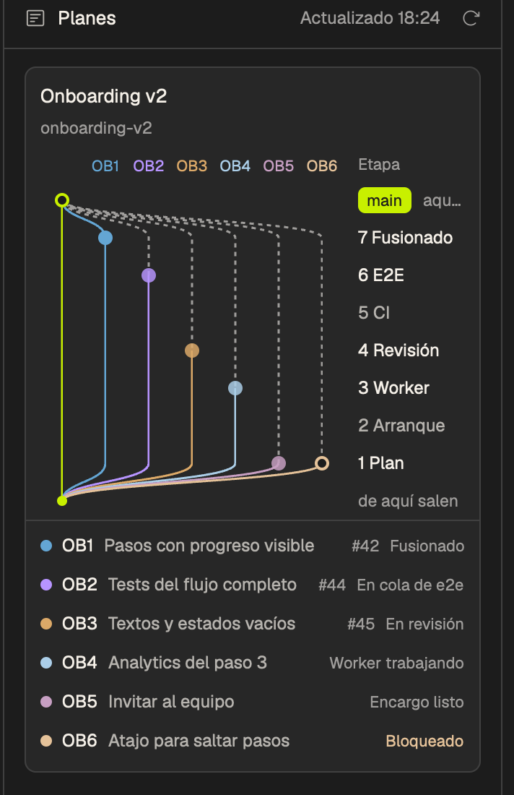

Every unit of a plan forks from `main`, climbs seven stages (Plan, Start, Worker, Review, CI, E2E, Merged) and merges back into `main` when its PR lands. Solid up to where it is, dashed after; a ring marks a blocked unit. It reads `estado.json` files that the bundled `plan-estado` command writes. More in [The Plans panel](#the-plans-panel-and-plan-estado).

### Closing on purpose

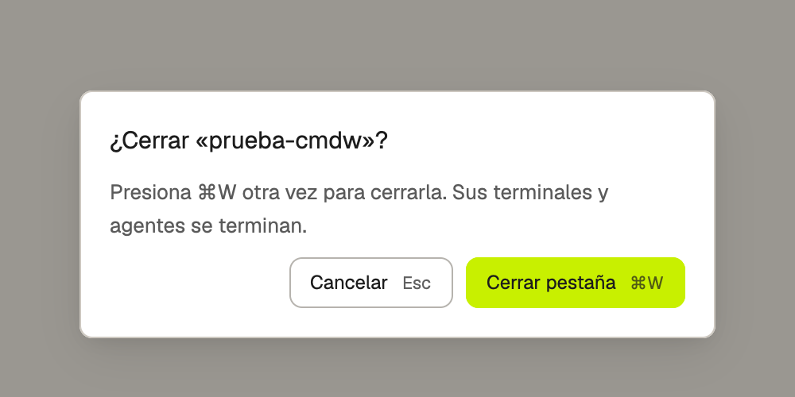

⌘W and ⌘⇧W open a dialog that names the tab or pane. It closes only on the same key again (or its button). Esc, a click outside or any other key cancels, and Enter does nothing, so a message you were typing can't close anything. Closes from scripts and agents don't go through it. The tab bar's ✕ asks too.

## Install

**Needs:** the Herdr desktop app (built on 0.1.15, macOS), opened at least once, and `python3`. The panels that talk to GitHub (Issues, Graph, Plans, Repositories) need `git` and the [GitHub CLI](https://cli.github.com) logged in.

```sh
git clone https://github.com/johanvillalbab/sho-herdr-mode.git
cd sho-herdr-mode
./install.sh --dry-run   # see what it would add
./install.sh             # install, then switch Herdr to the layout
```

What `install.sh` does:

- Copies the layout, the two themes and the mods into `~/.config/herdr-app` (or `$HERDR_APP_HOME`).
- Adds the [keys](#keys) to your `keys.json`. Herdr's own ⌘W and ⌘⇧W are replaced by the close confirmations; any other key you already use is left alone and reported.
- Never overwrites: if a file of yours would change, it stops and lists it. `./install.sh --replace` moves those files to `~/.config/herdr-app/backup-sho-herdr-mode-<time>/` first (and keeps your `config.json` settings).
- Runs `herdr-app check` on every mod and switches Herdr to the layout. Your own layout stays; `layout.switch` (⌘⇧L) goes back.
- `--plan-estado` also installs the `plan-estado` command into `~/.local/bin`.

Running it again is safe: what's already there and the same is skipped.

**By hand:** copy `layouts/main-craft.json`, `layouts/main-craft.png`, `themes/*.json` and every folder in `mods/` into the same places under `~/.config/herdr-app`, merge `keys.json` into yours, then run `herdr-app do layout.switch --name main-craft`.

## Settings for the optional panels

Three panels have personal settings. Each folder has a `config.example.json`; copy it to `config.json` next to it and edit. Saving it reloads the panel. `config.json` is yours: the installer keeps it and git ignores it.

**`mods/craft-local/config.json`**: the CI row. Without it, Localhost shows alone.

```json
{ "vm": "mac-ci", "repo": "your-user/your-repo", "runnerLabel": "mac-ci" }
```

`vm` is a [Lima](https://lima-vm.io) VM (`limactl list`), `repo` the repo its GitHub Actions runner serves, `runnerLabel` the runner's label. The dot is lime while a job runs, green when ready, amber when the VM is up but its runner isn't.

**`mods/craft-repos/config.json`**: where new clones go, under your home folder (default `Developer`).

```json
{ "cloneInto": "Developer" }
```

**`mods/craft-plans/config.json`**: see [The Plans panel](#the-plans-panel-and-plan-estado).

```json
{ "plansDir": "plans", "otherMachine": null, "repo": "your-user/your-repo" }
```

Some panels speak Spanish, as their author does: Plans, the close dialogs, and the message Issues sends to agents (its last line is the `ASK` constant at the top of `mods/craft-issues/main.js`).

## Keys

| Keys | Where | Does |
| --- | --- | --- |
| ⌘W | everywhere | asks, then closes the tab on a second ⌘W |
| ⌘⇧W | everywhere | asks, then closes the pane on a second ⌘⇧W |
| ⌘⌥B | this layout | shows or hides the right panel |
| ⌘G | this layout | Graph |
| ⌘⇧I | this layout | Issues |
| ⌘⇧N | this layout | Notes |
| ⌘⇧O | this layout | Plans |
| ⌘↩ / ⌘⇧↩ | Issues | send to the tab's agents / create on GitHub |

Herdr's own keys keep working (⌘B for the sidebar, ⌘D to split, ⌘1…9 for tabs, ⌘⇧P for the palette).

## The Plans panel and plan-estado

The Plans panel is for people who run work as **plans** made of **units** (one unit is one branch and one PR), handed to agents and reviewed before merging. Each plan is a folder with an `estado.json`:

```json
{
  "version": 1,
  "paquete": "onboarding-v2",
  "titulo": "Onboarding v2",
  "estado": "activo",
  "artefactos": [{ "titulo": "Decision: steps", "url": "https://…", "decision": "decidida", "fecha": "2026-11-17", "resumen": "…" }],
  "unidades": [
    {
      "id": "OB1", "titulo": "Steps with visible progress", "fase": "worker",
      "mac": "air", "poteto": false, "rama": "ui/ob1-steps", "pr": null,
      "depende": [], "encargo": "encargos/OB1.md", "nivel": null,
      "nota": "", "actualizado": "2026-11-17T22:00:58Z"
    }
  ],
  "actualizado": "2026-11-17T22:00:58Z"
}
```

A unit's `fase` maps to the seven stages: `decidido`, `encargo` (Plan) · `preparando`, `enviado` (Start) · `worker`, `cierre-worker` (Worker) · `revision`, `ronda` (Review) · `ci` (CI) · `cola-e2e`, `cadena` (E2E) · `fusionado`, `visto` (Merged), plus `bloqueado` and `descartado`. GitHub moves a unit forward when it's ahead: an open PR on its branch means at least Worker, a merged one means Merged. Clicking a unit opens its `encargo` file.

**Settings** (`mods/craft-plans/config.json`):

- `plansDir`: the plans folder, relative to your home on every machine (default: `plan-estado`'s folder, else `~/plans`).
- `otherMachine`: a machine from `hc machine ls` whose plans folder is read too; per unit, the newer `actualizado` wins. `null` for none.
- `repo`: the GitHub repo whose PRs move units forward. `null` for none.

**`plan-estado`** is the one way to write these files, so nobody edits JSON by hand. It's Python 3.9, standard library only; writes are atomic and locked.

```sh
plan-estado <plan> --crear "<title>"                         # create estado.json
plan-estado <plan> --nueva <unit> "<title>" [rama=… poteto=si|no encargo=…]
plan-estado <plan> <unit> fase=<fase> [pr=<n>] [mac=air|pro] [nivel=N1] [nota="…"] [depende=OB1,OB2]
plan-estado <plan> --cerrar                                  # close the plan
plan-estado decision <url> pendiente|decidida "<title>" [paquete=…] [nota="…"]
plan-estado ver [<plan>]                                     # print the state
plan-estado … --on <machine>                                 # run it on another machine (hc exec)
```

Its folder is `$PLAN_ESTADO_DIR`, else `dir` in `~/.config/plan-estado/config.json` (relative to home), else `~/plans`. Install it with `./install.sh --plan-estado`.

## What's in this repo

```
layouts/main-craft.json    the layout (and main-craft.png, its picture in Settings)
themes/craft-*.json        light and dark
mods/craft-tabs            tab bar and panel buttons
mods/craft-spaces          spaces sidebar
mods/craft-repos           the Spaces "+": your GitHub repos
mods/craft-local           CI and Localhost
mods/craft-issues          Issues
mods/craft-notes           Notes
mods/craft-plans           Plans
mods/git-graph             Graph (herdr-git-graph, in Craft's colors)
mods/tab-guard, pane-guard close confirmations
keys.json                  the keys install.sh merges into yours
tools/plan-estado          the command that writes plan state
install.sh                 the installer
RECIPE.md                  a brief to rebuild it from scratch
media/                     the video, its frames and screenshots
```

Herdr's own pieces the layout uses (`agents`, `files`, `pane`, `workspace-chrome`, `workspace-status`) ship with Herdr and aren't copied.

## Update and uninstall

**Update:** `git pull`, then `./install.sh --replace`. Your `config.json` files stay.

**Uninstall:** switch to another layout (⌘⇧L), then remove what was added:

```sh
cd ~/.config/herdr-app
rm -r layouts/main-craft.json layouts/main-craft.png themes/craft-light.json themes/craft-dark.json \
  mods/craft-tabs mods/craft-spaces mods/craft-repos mods/craft-local mods/craft-issues \
  mods/craft-notes mods/craft-plans mods/git-graph mods/tab-guard mods/pane-guard
```

and take this repo's sections out of `keys.json` (`mod:tab-guard`, `mod:pane-guard`, `layout:main-craft`, and set ⌘W / ⌘⇧W in `global` back to `tab.close` / `pane.close`). The installer left your previous `keys.json` in the backup folder if you want it whole.

## For agents

If someone asks you to install this: read [RECIPE.md](RECIPE.md) and `install.sh` first, tell them that the mods run programs (`git`, `gh`, `hc`, `lsof`, `limactl`) and read files under their home, then run `./install.sh --dry-run` and show them the plan before `./install.sh`. Never overwrite their files without `--replace` and their yes. After installing, `herdr-app status` should show no errors and `herdr-app shot` lets you look at the window.

## Credits and license

- Layout and mods by [Sho](https://github.com/johanvillalbab), for the [Herdr](https://herdr.dev) desktop app.
- Graph is [herdr-git-graph](https://github.com/rabeeh-ta/herdr-git-graph) by Rabeeh T A (MIT, [`mods/git-graph/LICENSE`](mods/git-graph/LICENSE)).
- Icons from [Phosphor](https://phosphoricons.com) (MIT).
- The video's figures are from Hairline.

MIT, see [LICENSE](LICENSE).
