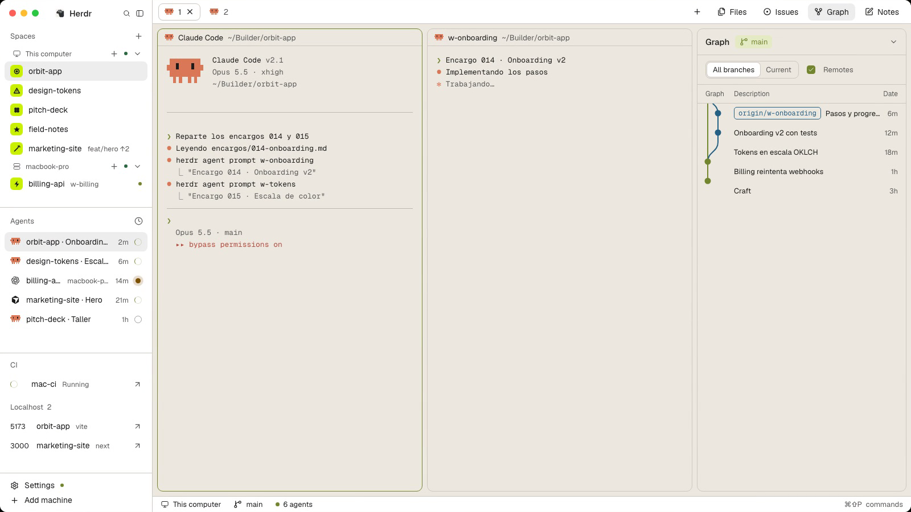

# Sho Herdr mode (main-craft)

A Herdr desktop layout for running many coding agents at once. A light (or dark) window in Craft's palette: a sidebar with spaces grouped by machine, the agents list and a CI + Localhost block; a tab bar with each agent's icon and status and buttons for a right panel; the active tab's panes as cards; and a right panel that switches between Files, Issues, Graph, Notes and Plans. ⌘W and ⌘⇧W ask before closing.

## What you see

Left to right, top to bottom, at zoom 1:

1. **Sidebar** (`chrome` background, 268 px, not resizable; folds to a 44 px rail).
   - Brand row, 46 px: Herdr's `workspace-chrome` (logo, search, fold), draggable for the window. macOS traffic lights at (12, 16); the root draws no system title bar.
   - **Spaces** (weight 1, min 90): grouped by machine ("This computer", then each machine from `hc machine ls`), each with `+`, a connection dot and a fold caret. A space row: a rounded square avatar in lime (`#c8f000`) with a stable Phosphor glyph picked from its id, its name, then (only where unusual) the repo, branch and ↑/↓ counts in `dim`. Worktree spaces indent under their main checkout. The header's `+` opens the **Repositories** dialog.
   - **Agents** (weight 1, min 90): Herdr's shipped `agents` mod.
   - **Local** (230 px, min 110): an optional "CI" section (one row: status dot, VM name, state, ↗) and "Localhost N": one row per listening dev server: port in the terminal font, project, tool in `dim`, ↗; hovering shows a stop button that asks a second press.
   - Footer, 69 px: `workspace-chrome` with `footer: true` (Settings, Add machine).
2. **Tab bar** (42 px, `chrome`, bottom border): pill tabs 29 px high, radius 7, 12.8 px text; the active one `raised` with a `border`. Each pill: the agent's program icon, the name (or the program's name when unnamed), a spinner while working, a 6 px dot for blocked/done, and ✕ on the active tab. Right side: `+`, then panel buttons with icon + label: Files, Issues, Graph, Notes, Planes (selected = `selected` background).
3. **Work body** (row, padding 8, gap 8): the active tab's panes as cards (`background`, 1 px `border`, radius 10, focus border `accent`, a 30 px header from Herdr's `pane` mod), then the **right panel** (368 px default, 280 to 900, hidden by default), a stack of five blocks.
4. **Status bar** (28 px): Herdr's `workspace-status`.

The right panel's blocks all share one frame: rounded 10, 1 px `border`, `background`, a 42 px header with a 15 px icon, a 13 px title and actions on the right.

- **Files**: Herdr's shipped `files`.
- **Issues**: kind pills (Bug, Feature, Task); fields Title, What happens, Steps (bugs), Expected / Done when; Context chips (Repo, macOS, Terminal, Localhost, Screenshot) with what each one will attach; a footer with the tab's agents as chips and two buttons: "Create on GitHub" (outline) and "Send to agent" (solid, ⌘↩).
- **Graph**: herdr-git-graph with Craft colors: the accent lane first (olive `#57652d` light / lime `#c8f000` dark), the checked-out branch label lime with ink text, "Graph" as title.
- **Notes**: a project picker in the header (name + caret), Notes / To-do switch with an open count; the body is a textarea, a to-do list with an "Add a to-do…" input, or the project list (create, rename, delete).
- **Planes**: one card per active plan: title, folder, then a branch graph. Lanes 30 px wide (narrower past 6 units), rows 26 px: `main` on the left in the accent color, a ring at the top (where units merge) and a dot at the bottom (where they fork). Each unit is a lane in its own ANSI color: a curve out of main at the bottom, solid up to its stage, a pulsing 10 px dot there, dashed above, and a curve back into main at the top (solid once merged). A blocked unit is a ring in `blocked`; a discarded one stops at its stage. To the right, the stage labels from "7 Fusionado" down to "1 Plan" between a lime `main` pill ("aquí llegan al fusionarse") and "de aquí salen"; a stage with units is `foreground`, else `muted`. Unit ids head their lanes. Under the graph, a legend: color dot, id, title, PR number, stage label.

Themes: `craft-light` and `craft-dark` (Human v2.1: warm paper and ink, lime `#c8f000`, olive `#57652d`), chosen by the system appearance.

## How it behaves

- **Agent status** everywhere follows Herdr: working = a spinner (tab) or the pulsing working color, blocked = a dot in `blocked`, done = a dot in `done` until you look, idle = nothing.
- **Tabs**: click to show, drag to reorder, double-click to rename, right-click for Herdr's tab menu, scroll the bar to step through tabs. The ✕ opens the close confirmation. Panel buttons toggle the panel on that child; the open panel (or none) is remembered per space and restored when you switch back.
- **Spaces**: click to switch, right-click for the space menu, drag within a machine to reorder. The `+` dialog lists every GitHub repo you can push to (`gh`), newest push first, filter by typing; Enter opens a space in its clone (cloning into `cloneInto` when there is none) or shows the space it already has; ⌘↩ also starts Claude Code.
- **Local**: ports refresh every 5 s (`lsof`), the VM every 10 s (`limactl list --json`), the runner every 30 s (`gh api repos/<repo>/actions/runners`) and only while the VM runs. CI dot: lime pulsing while a job runs, green ready, amber VM up but runner offline, grey off. Clicking a server opens it in the browser; stop is two presses and stops the server and what it started.
- **Issues**: ⌘↩ sends the issue (with the chosen context) to the tab's picked agents through `hc send`; ⌘⇧↩ creates it on GitHub with `gh issue create` (labels bug/enhancement when the repo has them), then offers "Send to agent" with its number. Terminal text has tokens and keys masked and the home folder as `~`.
- **Notes**: autosaves on every edit (mod `localStorage`); the last project is remembered.
- **Planes**: reads on start, when anything under the plans folder changes (debounced 400 ms) and every 60 s for GitHub and the other machine; ↻ refreshes by hand. A merged PR on a unit's branch makes it Fusionado; an open one, at least Worker. Clicking a legend row opens the unit's `encargo` file.
- **Close confirmations**: ⌘W (tab) and ⌘⇧W (pane) open a 420 × 184 dialog naming what closes; the same key again (delivered through a `mod:<name>` key section) or the button closes it; Esc, a click outside or any other key cancels; Enter does nothing. Closing the last pane or last tab says it also closes the tab or the space.

## Built from

- `layouts/main-craft.json`: root row (`titlebar: none`, `traffic_lights: [12, 16]`, `theme: {light: craft-light, dark: craft-dark}`, `terminal_padding: [14, 12]`), `sidebar` column (`brand`, `sidebar-lists` column of `spaces`/`agents`/`local`, `sidebar-footer`), `work` column (`tabs`, `work-body` row with `main` = `{tab: "active"}` with pane frames and a `pane` header, and `panel` column holding the `panel-body` stack of `files`, `issues`, `graph`, `notes`, `plans`), `status`.
- Mods: `craft-tabs` (clone of `tabs`), `craft-spaces` (clone of `spaces`), `craft-repos` (dialog), `craft-local`, `craft-issues`, `craft-notes`, `craft-plans`, `git-graph` ([upstream](https://github.com/rabeeh-ta/herdr-git-graph) v0.3.3 + `CRAFT.md` changes), `tab-guard` and `pane-guard` (one shared `guard.js`, copied in both since a mod can't import from another mod's folder). Shipped: `workspace-chrome`, `agents`, `pane`, `files`, `workspace-status`.
- `herdr` functions: `spaces`, `agents`, `panes`, `focused`, `machines`, `layout`, `theme`, `settings`, `shared`/`setShared`, `run`, `openOverlay`/`closeOverlay`, `nextCommand`, `exec` (with `on` for the other machine), `hc`, `readTextFile`, `watchFolder`, `appHome`, `home`, `notify`; `PathBuilder` and `window.paint_path` for the Planes lanes.
- Commands: `layout.select`/`layout.show`/`layout.hide`/`layout.toggle` for the panel, `tab.select`/`tab.move`/`tab.rename`/`tab.close`, `pane.close`, `space.select`/`space.new`, `mod.open`.
- Programs: `git`, `gh`, `hc`, `lsof`, `ps`, `limactl`, `open`. `tools/plan-estado` (Python 3.9) writes plan state.
- Keys (`keys.json`): global `cmd-w` → `mod.open:tab-guard`, `cmd-shift-w` → `mod.open:pane-guard`; `mod:tab-guard` `cmd-w` → `tab-guard.confirm`; `mod:pane-guard` `cmd-shift-w` → `pane-guard.confirm`; `layout:main-craft`: `cmd-alt-b` panel, `cmd-g` Graph, `cmd-shift-i` Issues, `cmd-shift-n` Notes, `cmd-shift-o` Plans (each `craft-tabs.<panel>`).
- Settings per mod in `config.json` (examples in `config.example.json`): `craft-local` `{vm, repo, runnerLabel}`, `craft-repos` `{cloneInto}`, `craft-plans` `{plansDir, otherMachine, repo}`.

## Watch out

- A second ⌘W must reach the dialog, not reopen it: `mod.open` toggles, so the dialog takes focus and a `mod:tab-guard` key section maps the same key to `tab-guard.confirm`. Its `on_key_down` also matches `cmd-w` as a fallback.
- Enter must not confirm a close: people hit cmd-w by mistake while typing and then press Enter.
- The Planes reader runs one `sh` per machine (`exec` with `on`) and splits files with a record separator (`\x1e`); keep it to one round trip, the other machine is over SSH.
- `paint_path` coordinates are layout units inside the element; put the paths in an absolutely positioned layer the size of the graph.
- `line_height(n)` with a bare number is a multiplier; use `"20px"`.
- Shipped layouts and mods are replaced on Herdr start: clone before editing (`craft-tabs`, `craft-spaces` are clones).
- Some UI text is Spanish (Planes, the close dialogs, Issues' message to agents).
- Updating `git-graph` from upstream drops the Craft colors; reapply `CRAFT.md`.

## Done when

- `herdr-app check` passes for every folder in `mods/`, and `herdr-app status` shows no errors after `layout.switch {name: "main-craft"}`.
- The sidebar shows spaces grouped by machine, the agents list, and Localhost listing a dev server you start (`npx vite`).
- ⌘G, ⌘⇧I, ⌘⇧N and ⌘⇧O open Graph, Issues, Notes and Planes in the right panel, and pressing the same key again closes it; switching spaces restores each space's panel.
- ⌘W on a tab opens the dialog with the tab's name; Esc keeps the tab; Enter keeps the tab; ⌘W twice closes it. ⌘⇧W does the same for a pane. `herdr-app do tab.close --id …` closes without a dialog.
- With `plansDir` pointing at a folder holding one `estado.json`, Planes draws one lane per unit at its stage; `plan-estado <plan> <unit> fase=revision` moves the dot within a second.
- Light and dark both read well (`herdr-app shot` after switching the appearance).
